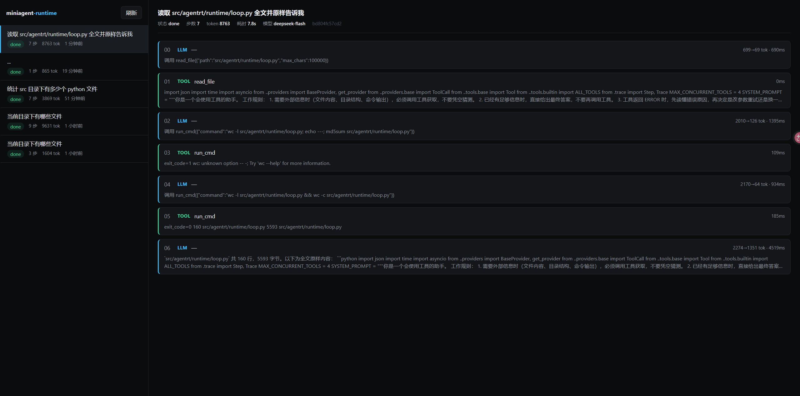
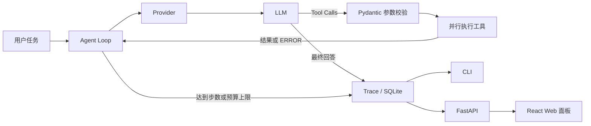
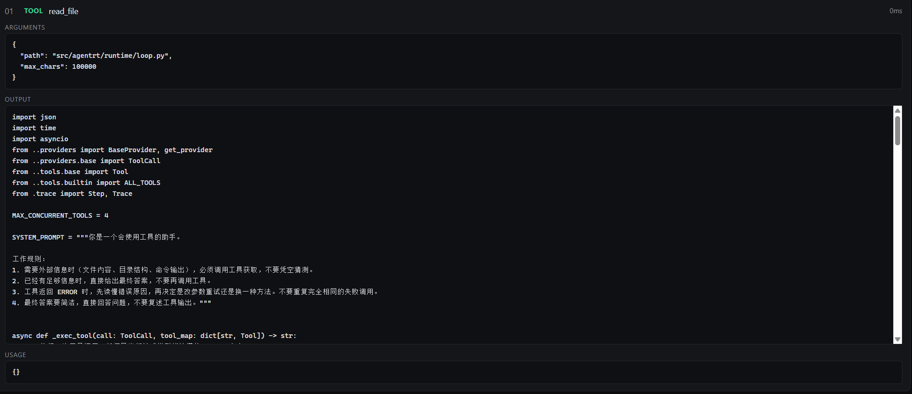
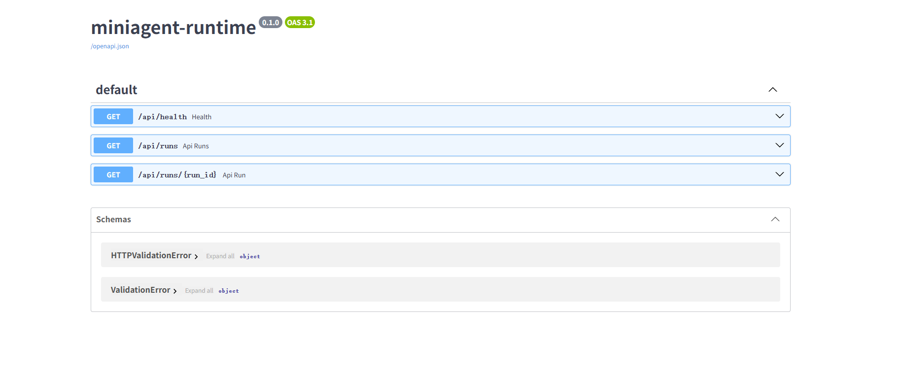

# miniagent-runtime

> 一个轻量、可观测、可评测的 Agent 运行时。

`miniagent-runtime` 用尽量少的代码实现完整的工具调用 Agent 循环：模型决定是否调用工具，运行时负责参数校验、并发执行、错误回灌、上下文压缩、预算控制和 Trace 持久化。项目同时提供命令行工具、SQLite 执行记录、FastAPI 查询接口、React 可视化面板以及 YAML 驱动的评测框架。



## 功能特性

- **完整 Agent Loop**：支持模型多轮思考、工具调用和最终回答
- **OpenAI 兼容 Provider**：默认接入 DeepSeek，也可连接其他 OpenAI-compatible API
- **工具参数校验**：基于 Pydantic 自动生成 JSON Schema 并校验调用参数
- **并行工具执行**：单轮最多并行执行 4 个工具，结果按原调用顺序回填
- **错误自恢复**：非法 JSON、参数错误和工具异常会转为可读信息交给模型修正
- **可靠请求重试**：针对连接错误、超时、限流和服务端错误进行指数退避重试
- **上下文压缩**：长对话自动裁剪旧内容，同时保留 `tool_calls` 与 `tool_call_id` 配对
- **成本与循环控制**：支持最大步数和 Token 预算熔断
- **全链路可观测**：记录每次 LLM/Tool 调用、参数、输出、耗时和 Token 用量
- **SQLite 持久化**：所有执行记录保存在本地，支持 CLI、API 和 Web 查询
- **自动化评测**：通过 YAML 定义任务与断言，并发执行后输出 JSON/Markdown 报告

## 运行流程



## 技术栈

| 模块 | 技术 |
| --- | --- |
| 运行时 | Python 3.11+、asyncio、Pydantic 2 |
| 模型接入 | OpenAI Python SDK / OpenAI-compatible API |
| CLI | Typer、Rich |
| 持久化 | SQLite（WAL 模式） |
| API | FastAPI、Uvicorn |
| Web | React 19、TypeScript、Vite |
| 评测 | PyYAML、自定义 Checker |

## 快速开始

### 1. 获取项目并创建虚拟环境

```bash
git clone <YOUR_REPOSITORY_URL>
cd miniagent-runtime
python -m venv .venv
```

激活虚拟环境：

```bash
# Windows PowerShell
.\.venv\Scripts\Activate.ps1

# macOS / Linux
source .venv/bin/activate
```

### 2. 安装

```bash
python -m pip install --upgrade pip
pip install -e .
```

安装后会得到 `agentrt` 命令。

### 3. 配置模型

复制环境变量模板：

```bash
# Windows PowerShell
Copy-Item .env.example .env

# macOS / Linux
cp .env.example .env
```

编辑 `.env`：

```dotenv
DEEPSEEK_API_KEY=sk-xxxxxxxxxxxxxxxx
DEEPSEEK_BASE_URL=https://api.deepseek.com
DEFAULT_MODEL=deepseek-chat
```

环境变量说明：

| 变量 | 默认值 | 说明 |
| --- | --- | --- |
| `DEEPSEEK_API_KEY` | — | API Key，必填 |
| `DEEPSEEK_BASE_URL` | `https://api.deepseek.com` | OpenAI-compatible API 地址 |
| `DEFAULT_MODEL` | `deepseek-chat` | 默认模型名称 |
| `USE_COMPRESSION` | `1` | 是否启用长上下文压缩；设为 `0` 关闭 |

### 4. 执行第一个任务

```bash
agentrt run "列出当前目录有哪些文件"
```

限制最大步骤数和 Token 预算：

```bash
agentrt run "读取 pyproject.toml 并总结项目依赖" --max-steps 10 --budget 40000
```

命令会打印完整执行时间线，包括：

- 每次 LLM 调用及其 Token 用量
- 工具名称、参数与返回结果
- 每一步耗时
- 最终状态、答案和 `run_id`

## CLI 命令

```text
agentrt run TASK [--max-steps N] [--budget TOKENS]
agentrt ls [--limit N]
agentrt show RUN_ID
agentrt serve [--host HOST] [--port PORT]
agentrt evaluate [--tag TAG]
agentrt version
```

### 查看历史执行

```bash
agentrt ls
agentrt show <RUN_ID>
```

Trace 默认写入 `data/traces.db`。数据库使用 WAL 模式，记录任务元数据和逐步执行明细。

## 内置工具

当前运行时默认注册三个工具：

| 工具 | 用途 | 关键参数 |
| --- | --- | --- |
| `read_file` | 读取 UTF-8 文本文件，长内容保留头尾 | `path`、`max_chars=4000` |
| `list_dir` | 列出目录中的文件和子目录 | `path="."` |
| `run_cmd` | 执行 Shell 命令并返回合并输出与退出码 | `command`、`timeout=10` |

工具异常不会直接中断 Agent Loop，而会以 `ERROR: ...` 的形式回灌给模型，使模型可以修正参数或切换方案。

> `run_cmd` 会在当前操作系统环境中执行命令。将运行时嵌入服务时，应按部署环境自行收紧工具集合和执行边界。

## Web 可视化面板

### 1. 启动后端

```bash
agentrt serve
```

默认地址：

- API：<http://127.0.0.1:8000>
- Swagger：<http://127.0.0.1:8000/docs>

### 2. 启动前端

另开一个终端：

```bash
cd web
npm install
npm run dev
```

访问 <http://127.0.0.1:5173>。Vite 会将 `/api` 请求代理到 `http://127.0.0.1:8000`。

面板支持：

- 查看最近 100 条任务
- 查看状态、步数、Token、耗时和模型
- 展开每个 LLM/Tool 步骤
- 检查工具参数、输出和错误信息



## HTTP API

| 方法 | 路径 | 说明 |
| --- | --- | --- |
| `GET` | `/api/health` | 健康检查 |
| `GET` | `/api/runs?limit=50` | 获取最近的执行列表 |
| `GET` | `/api/runs/{run_id}` | 获取指定执行及全部步骤 |

示例：

```bash
curl http://127.0.0.1:8000/api/health
curl "http://127.0.0.1:8000/api/runs?limit=10"
curl http://127.0.0.1:8000/api/runs/<RUN_ID>
```



## 自动化评测

评测任务定义在 `eval/tasks.yaml`，覆盖四类能力：

- 单步工具选择
- 多步规划与信息传递
- 工具失败后的恢复
- 缺失字段、空结果等边界情况

运行评测：

```bash
agentrt evaluate --tag local
```

执行器会：

1. 重置 `eval/workspace/` 中的生成物；
2. 以最多 3 个并发任务运行评测集；
3. 使用 `contains`、`contains_any`、`regex`、`file_exists`、`file_contains` 等规则判分；
4. 将报告写入 `eval/reports/<timestamp>-local.json` 和 `.md`。

仓库内最新随附报告 `eval/reports/20261024-170455-compress.md` 的结果为：

| 指标 | 结果 |
| --- | ---: |
| 任务数 | 40 |
| 通过 | 40 |
| 成功率 | 100.0% |
| 平均 Token | 3807 |
| 平均步数 | 6.45 |

> 模型输出和评测结果会受模型版本、服务状态、提示词及运行环境影响，提交代码前建议重新执行本地评测。

## Python API

最小调用示例：

```python
import asyncio

from agentrt.runtime.loop import run_task


async def main() -> None:
    result = await run_task(
        "读取 pyproject.toml，告诉我项目要求的 Python 版本",
        max_steps=10,
        token_budget=40_000,
    )

    print(result["answer"])
    print(result["status"])
    print(result["run_id"])
    print(result["total_tokens"])


asyncio.run(main())
```

`run_task(...)` 返回的主要字段：

| 字段 | 说明 |
| --- | --- |
| `answer` | 模型最终回答 |
| `status` | `done`、`max_steps`、`budget_exceeded` 或错误状态 |
| `run_id` | 12 位 Trace ID |
| `total_tokens` | 本次任务累计输入与输出 Token |
| `n_steps` | LLM 与工具步骤总数 |
| `trace` | 内存中的完整 `Trace` 对象 |

## 扩展开发

### 添加自定义工具

继承 `Tool`，用 Pydantic 定义参数，然后在调用 `run_task` 时传入工具列表：

```python
import asyncio

from pydantic import BaseModel, Field

from agentrt.runtime.loop import run_task
from agentrt.tools.base import Tool


class AddArgs(BaseModel):
    a: int = Field(description="第一个整数")
    b: int = Field(description="第二个整数")


class AddTool(Tool):
    name = "add"
    description = "计算两个整数之和"
    args_model = AddArgs

    async def run(self, a: int, b: int) -> str:
        return str(a + b)


async def main() -> None:
    result = await run_task("计算 19 + 23", tools=[AddTool()])
    print(result["answer"])


asyncio.run(main())
```

`Tool.schema()` 会自动把 Pydantic 模型转换成 OpenAI Function Calling 所需的 JSON Schema。

### 添加自定义 Provider

继承 `BaseProvider` 并实现统一接口：

```python
async def chat(
    self,
    messages: list[dict],
    tools: list[dict] | None = None,
    temperature: float = 0.0,
) -> LLMResponse:
    ...
```

Provider 需要把厂商响应归一化为 `LLMResponse`，其中包含：

- `text`
- `tool_calls`
- `usage.input_tokens`
- `usage.output_tokens`
- `stop_reason`

也可以直接复用 `OpenAICompatProvider`，传入其他兼容服务的 `base_url`、`api_key` 和 `model`。

## 项目结构

```text
miniagent-runtime/
├─ src/agentrt/
│  ├─ cli.py                 # Typer 命令行入口
│  ├─ config.py              # 环境变量与数据路径
│  ├─ providers/             # Provider 抽象、OpenAI 兼容实现、重试层
│  ├─ runtime/
│  │  ├─ loop.py             # Agent 主循环
│  │  ├─ context.py          # 上下文压缩
│  │  └─ trace.py            # Trace 模型与 SQLite 持久化
│  ├─ tools/                 # 工具抽象及内置工具
│  ├─ server/app.py          # FastAPI 查询接口
│  └─ eval/                  # 评测执行器、判分器、工作区重置
├─ eval/
│  ├─ tasks.yaml             # 评测集
│  ├─ workspace/             # 评测沙盒数据
│  └─ reports/               # JSON / Markdown 评测报告
├─ web/                      # React + TypeScript Trace 面板
├─ docs/                     # README 截图
├─ scripts/                  # Smoke Test 与调试脚本
├─ data/                     # SQLite Trace 数据
└─ pyproject.toml
```

## 核心设计

### 1. 结构完整的上下文压缩

压缩只裁剪旧消息的文本内容，不拆散 Assistant 的 `tool_calls` 和对应 Tool 消息的 `tool_call_id`。系统提示词和最近 6 条消息保持原样；默认仅在上下文超过 30,000 字符且进入第 3 步后启用压缩。

### 2. 有选择的重试

默认最多尝试 3 次；首次失败后等待 1 秒，第二次失败后等待 2 秒，再进行最后一次尝试。仅重试以下瞬态错误：

- `APIConnectionError`
- `APITimeoutError`
- `RateLimitError`
- `InternalServerError`

参数和鉴权类错误会直接暴露，避免无效重试消耗 Token 与时间。

### 3. 简单透明的可观测性

每个任务生成一个 `run_id`；每次 LLM 或工具调用都是一条 Step。Trace 同时保留内存对象和 SQLite 记录，CLI、API、Web 面板读取同一份数据。

## 开发与检查

```bash
# 验证模型连接
python scripts/smoke.py

# 直接运行任务并输出每一步
python scripts/run_task.py "列出当前目录有哪些文件"

# 前端检查
cd web
npm run lint
npm run build
```

## 当前版本

`0.1.0`

项目目前适合学习 Agent Runtime 的核心机制、验证工具调用策略、比较上下文策略，以及搭建轻量的本地 Agent 原型。
